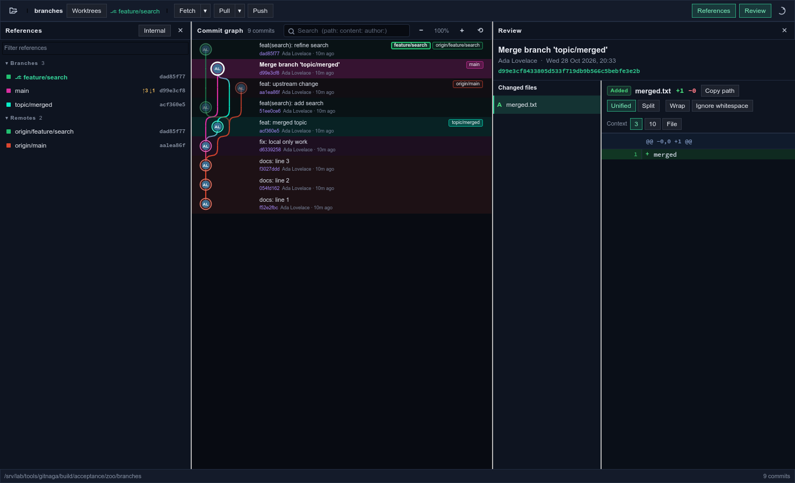
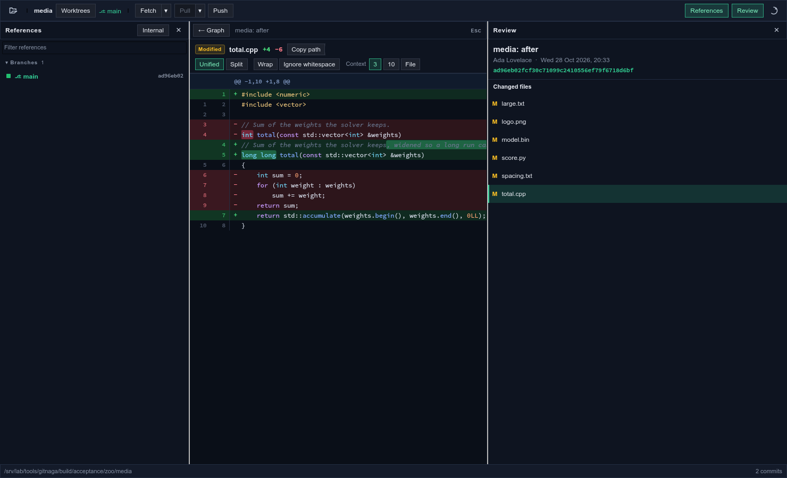
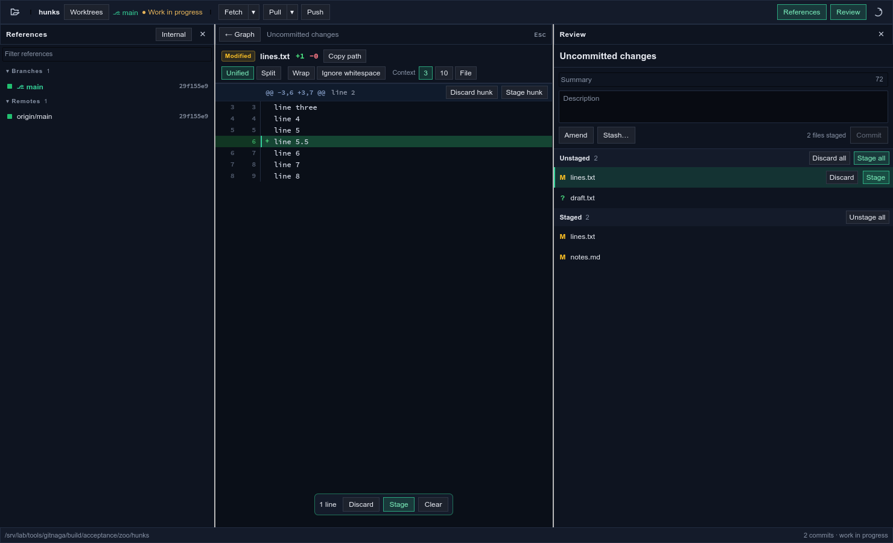
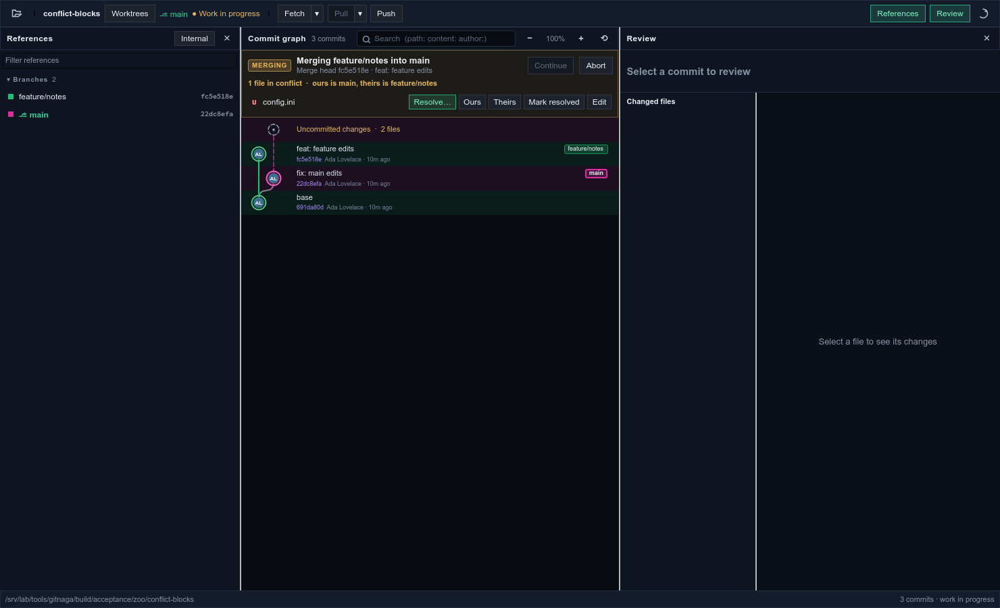

# GitNaga

[](https://github.com/blackopsrepl/gitnaga/actions/workflows/ci.yml)

<p align="center">
  
</p>

A native Linux Git client built with C++23 and Qt 6 QML, for one person and
their repositories. The commit graph sits in the centre, every Git action is
one click, drag or keystroke away, and it talks to Git directly: no daemon, no
library wrapper, no account, no cloud, no telemetry.

## Highlights

- **A graph that stays fast.** A million commits paint their first rows in
  about 150 ms and stream in without a dropped frame (see
  [`docs/PERFORMANCE.md`](docs/PERFORMANCE.md)). Branch colours follow their
  line, merges get a heavier marker, and hovering or selecting a commit lights
  its ancestry.
- **The refs you use.** Local branches, remotes, tags and stashes, read from
  Git's own refs. Tool namespaces, filter-branch backups and remote `HEAD`s
  stay behind the **Internal** toggle. Hide a branch from the graph with its
  eye, or solo one to see only its history.
- **Fetch, pull and push.** Ahead/behind counts on the toolbar and every
  branch, auto-fetch when a repository opens and every ten minutes, three
  pull modes, publishing with an upstream, and force push only with lease.
  Password and passphrase prompts from https and ssh remotes get GitNaga's own
  dialog.
- **Staging the way you think.** Unstaged and staged sections, stage or discard
  by file, by hunk, or by the lines you pick in the gutter. Amend (with a
  warning once HEAD is pushed), stash with or without untracked files, apply,
  pop and drop.
- **A diff worth reading.** Pick a file and its diff takes the middle of the
  window: unified or side by side, syntax highlighting, word-level changes,
  visible whitespace when that is all that changed, old and new images side
  by side, and cards for binaries, submodule moves and LFS pointers.
- **Half-done operations, handled.** A banner for a stopped merge, rebase,
  cherry-pick, revert or bisect, with Continue, Skip and Abort; per-file Ours,
  Theirs, your editor or your merge tool; and a conflict view that resolves
  block by block.
- **History you can shape.** An interactive rebase editor with drag to
  reorder, reword, squash, fixup and drop; edit a message, squash into the
  parent or drop a commit from its menu; drag a branch chip onto a commit to
  merge, rebase or reset.
- **Undo.** Ctrl+Z takes back commits, amends, checkouts, branch and tag
  changes, merges, rebases, pulls, cherry-pick sequences and stash drops. A
  push ends the history, since what was published is shared.
- **Find anything.** Ctrl+F searches messages, authors, hashes, paths
  (`path:`) and content (`content:`); file history follows renames; blame
  shows each line's commit; Ctrl+K opens a palette of every command, branch
  and tag; the graph moves by keyboard.
- **Linked worktrees.** Add, open, move, lock, remove, prune and repair.

## Screenshots

<p align="center">
  
</p>

<p align="center">
  
</p>

<p align="center">
  
</p>

## Build and run

GitNaga needs a C++23 compiler, CMake 3.31 or newer, Ninja, and Qt 6.9.1 or
newer with the Quick, QuickControls2, and Concurrent modules.

```bash
make            # show the available targets
make build      # configure and build the debug preset
make run REPO=/path/to/repository
```

Without Make, the underlying CMake presets are the same:

```bash
cmake --preset dev
cmake --build --preset dev
./build/dev/gitnaga /path/to/repository
```

Passing a repository path is optional. With no argument, GitNaga opens on an
empty state and waits for the **Open Repository** button (or Ctrl+O).

## Verify

```bash
make test       # build and run the ctest suite
make lint       # lint every QML file with qmllint
make ci-local   # configure, build, test, and lint in one pass
python3 scripts/acceptance.py   # drive the real window through the fixture zoo
```

The tests drive the controller against real scratch repositories: staging and
patch building, sync against a bare remote, fetch through authenticating HTTP
and ssh servers, conflicts and stopped operations, undo, interactive rebase,
search, file history and blame, diffs of images, submodules and LFS pointers.
`scripts/acceptance.py` builds a zoo of repositories in every state GitNaga
handles and drives the real window through each (`src/ui_driver.hpp`), saving
the screenshots a release is looked at against. The source-size contract
rejects any source, QML, or test file at or above 300 lines.

## Layout

See [`WIREFRAME.md`](WIREFRAME.md) for the interface specification and
[`docs/ROADMAP.md`](docs/ROADMAP.md) for how GitNaga got from demo to daily
driver.

| Path | Contents |
|------|----------|
| `src/git_client.*` | The process runner every Git command goes through: no timeout, cancellable, queued |
| `src/git_refs.*`, `src/git_status.cpp`, `src/git_history.cpp` | Typed refs, worktree status and streamed history |
| `src/git_sync.*`, `src/askpass.*` | Fetch, pull, push and the credential dialog |
| `src/git_staging.*`, `src/patch_builder.*` | Staging by file, hunk and line |
| `src/git_rebase.*`, `src/rebase_todo.*` | Interactive rebase |
| `src/file_diff*`, `src/diff_*`, `src/syntax_*`, `src/intraline_diff.*` | Diff loading, special files, highlighting and word changes |
| `src/repository_controller.*` | Repository, selection and operation state for QML |
| `src/remote_sync.*`, `src/history_editor.*`, `src/operation_controller.*`, `src/worktree_manager.*` | The controller's parts: `repository.sync`, `.history`, `.operation`, `.worktreeManager` |
| `src/undo_*` | What each operation needs to be taken back |
| `src/navigation_controller.*`, `src/search_controller.*` | Search, file history, blame and the palette |
| `src/commit_model.*`, `src/commit_graph_*`, `src/graph_*` | The history model and the painted graph |
| `qml/` | The window: graph, sidebars, diff view, dialogs |
| `scripts/fixture-zoo.sh`, `scripts/acceptance.py` | The fixture zoo and the visual acceptance run |
| `tests/` | Real-Git controller and integration tests |

## License

GPL-3.0-or-later. See [LICENSE](LICENSE).
